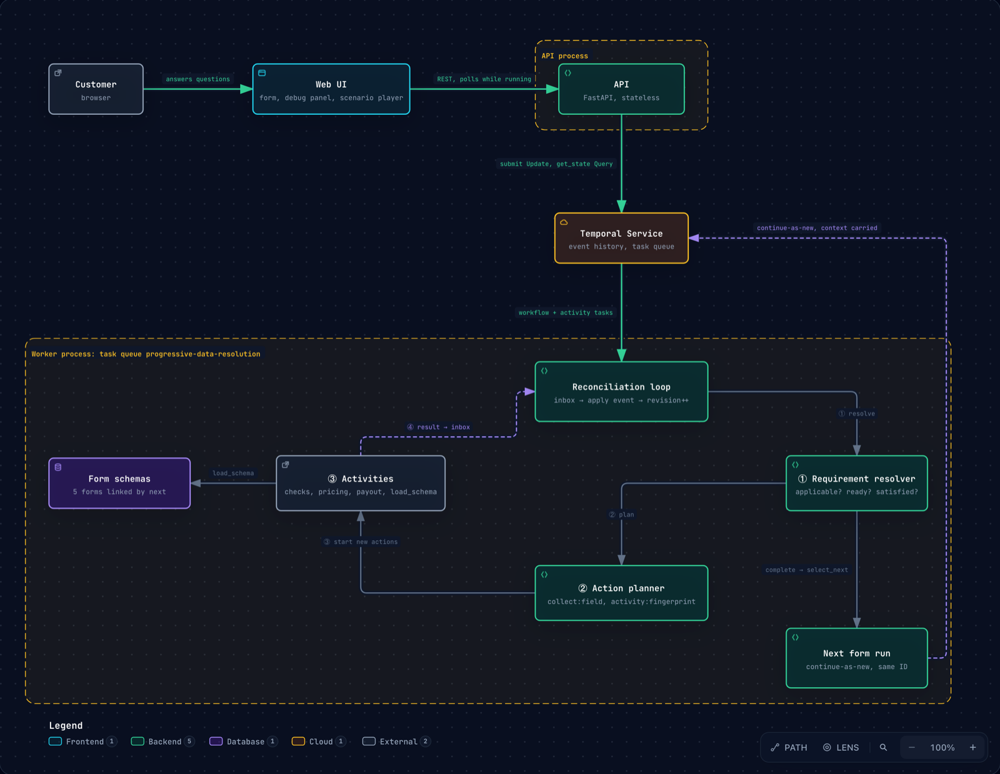
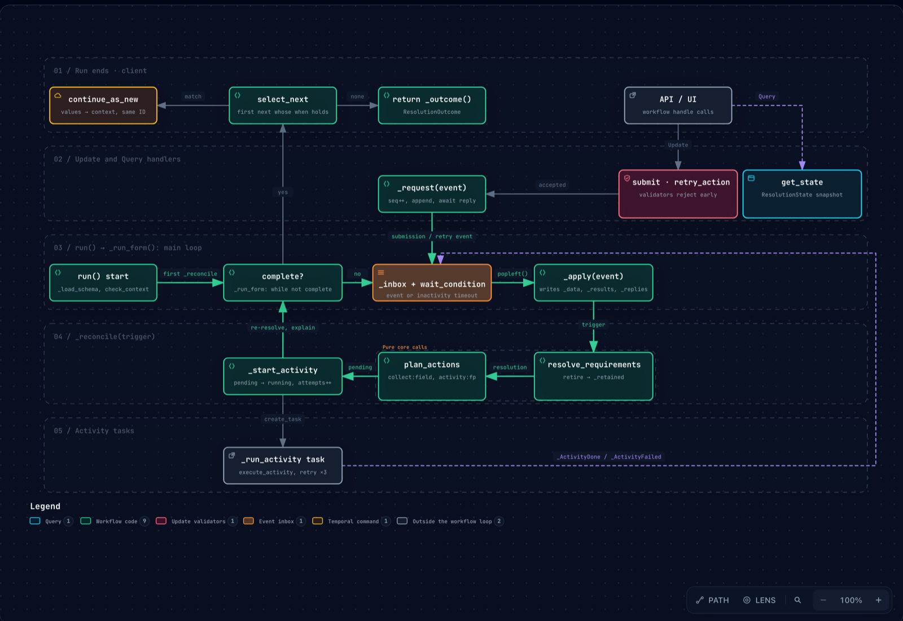

# Progressive Data Resolution (Declarative Reconciliation)

> [!WARNING]
> **This is an experiment, not a recommended pattern.** It explores whether
> Temporal can host a schema-driven engine whose steps are decided at runtime.
> It is not guidance on how to build workflows. Running a custom rule language
> inside a workflow has real costs:
> - **Logic moves into configuration.** Business logic leaves code and becomes
>   JSON, where it is harder to type-check, test, review and debug.
> - **History records the engine, not the process.** Event history shows what
>   the interpreter did, not the business steps.
> - **Schema changes need their own versioning.** They need the same care as
>   code changes, outside Temporal's workflow versioning tools.
>
> For most processes, write the steps as ordinary workflow code, and use
> Signals, Updates and conditions for the parts that depend on input. The
> activities here are mocks, and the sample has no authentication.

A long-running workflow that is never told the order of its steps. A versioned
JSON schema describes the data a loan application needs, which fields depend on
which, and which values come from automated checks. The workflow keeps working
out what is still missing and closes the gap: it asks a person, runs an
activity, or waits. It finishes once every applicable requirement is satisfied.

The pattern underneath is a **reconciliation loop**, like a Kubernetes
controller:

| | |
|---|---|
| Desired state | Every requirement that applies is satisfied. |
| Actual state  | The data collected so far, plus activity results for the *current* inputs. |
| Reconcile     | Resolve requirements, plan actions, start what can run. |
| Triggers      | Updates (human input), activity completions, retries, a timer. |
| Durability    | Temporal keeps the loop, its state and in-flight work alive across failures and long gaps. |

The sample is a small tree of forms. A **loan application** collects details
and runs identity, affordability and credit checks. What follows depends on how
it ended and why:
- **Approved:** a **loan offer** shaped by the application. Accepting the offer
  leads to **disbursement**; declining it leads to **offer feedback**.
- **Declined only because it was unaffordable:** an **affordability review**.

Choosing "self-employed" instead of "employed" asks different questions in
every form, and correcting an answer halfway through re-plans the checks. None
of that changes workflow code.

## How it works

[](doc/architecture.html)

For an interactive version, open [doc/architecture.html](doc/architecture.html)
in a browser. It is generated from
[doc/architecture.archify.json](doc/architecture.archify.json).

```
schemas/*.json ──► core/ (pure, no Temporal)              workflow.py (Temporal)
                   ┌──────────────────────────┐           ┌──────────────────────────────┐
                   │ schema.py   validate     │           │ inbox ◄── submit (Update)     │
                   │ rules.py    5 operators  │  called   │       ◄── retry_action        │
                   │ resolver.py what's needed├──────────►│       ◄── activity results    │
                   │ planner.py  what to do   │  by the   │ loop: apply event → resolve   │
                   │ surface.py  what to show │   loop    │   → plan → start activities   │
                   └──────────────────────────┘           │ get_state (Query)             │
                                                          └──────────────┬───────────────┘
            static/index.html ◄── api.py (FastAPI) ── query/update ──────┘
```

- [core/](core/) is the decision-making half. It never imports Temporal, so
  everything in it is a plain, deterministic function you can unit test without
  a server.
  - [rules.py](core/rules.py) defines the rule language: `equals`, `notEquals`,
    `exists`, `and`, `or`. Evaluation is three-valued: a rule about a field
    nobody has answered yet comes out *unknown*, not false.
  - [schema.py](core/schema.py) validates a schema before anything runs. It
    rejects unknown keywords, activities outside the allowlist, references to
    unknown fields, and reference cycles.
  - [resolver.py](core/resolver.py) is
    `resolve_requirements(schema, data, results, actions)`. It gives every field
    a status (`not_applicable`, `blocked`, `missing`, `in_progress`,
    `satisfied`, `failed`) and a reason, and decides completion and the outcome.
  - [planner.py](core/planner.py) is `plan_actions(...)`. It turns missing
    requirements into actions with derived ids, so planning again never
    duplicates work.
  - [submission.py](core/submission.py) checks a submission and separates
    *invalid* values from *conflicts* with newer state.
  - [surface.py](core/surface.py) projects workflow state into UI components.
- [workflow.py](workflow.py) is the orchestration half. It runs
  `ProgressiveDataResolutionWorkflow`.
- [activities.py](activities.py) holds `load_schema` and six deterministic
  mocks:
  - identity, affordability and credit checks;
  - offer pricing;
  - household affordability;
  - payout booking.

  `AUTOMATED_ACTIVITIES` is the only set of activities a schema can name.
- [api.py](api.py) and [static/index.html](static/index.html) are a stateless
  API and a page with no build step. The page has no knowledge of loan
  applications. It renders whatever components the surface lists.
- [static/scenarios.json](static/scenarios.json) holds demo scenarios that the
  page can fill in or play. See [Scenarios](#scenarios).
- [schemas/](schemas/) holds the five forms:
  - [loan_application](schemas/loan_application.v1.json);
  - [loan_offer](schemas/loan_offer.v1.json);
  - [disbursement](schemas/disbursement.v1.json);
  - [offer_feedback](schemas/offer_feedback.v1.json);
  - [affordability_review](schemas/affordability_review.v1.json).

  See [Branching follow-up forms](#branching-follow-up-forms).

### The schema

A field declares three things:
- **Applicability:** `required: true`, or `requiredWhen` a rule holds.
- **Readiness:** for activity fields only. `dependsOn` lists fields that must be
  satisfied or not applicable, and `readyWhen` is a rule that must hold.
- **Collection strategy:** `human`, or an `activity` from the registry.

```json
"business_registration": {
  "type": "string", "pattern": "BR-[0-9]{6}",
  "requiredWhen": {"field": "employment_type", "equals": "self_employed"},
  "collection": {"strategy": "human"}
},
"affordability_assessment": {
  "type": "object", "required": true,
  "dependsOn": ["employment_type", "annual_income", "business_operating_years"],
  "readyWhen": {"field": "consent_to_checks", "equals": true},
  "collection": {"strategy": "activity", "activity": "assess_affordability"}
}
```

Completion is implicit: every applicable requirement is satisfied. A separate
`outcome` list derives the business verdict from the collected data, and the
first match wins. A failed identity check therefore still *completes* the
process, with outcome `declined`. Only failures of the engine itself count as
failures.

Validation keywords are limited to `enum`, `min`/`max`, `minLength`/`maxLength`
and `pattern`. There is no expression language and no executable content.

The format is defined as a JSON Schema (draft 2020-12) in
[schemas/progressive-data-resolution.schema.json](schemas/progressive-data-resolution.schema.json).
Each schema file points at it through `"$schema"`, so editors validate and
autocomplete while you write. The JSON Schema covers everything structural:
- keywords and their types;
- which keywords suit which field type;
- `required` vs `requiredWhen`;
- the shape of the rule language;
- the activity allowlist.

The loader ([core/schema.py](core/schema.py)) is still authoritative. It also
checks what JSON Schema can't express:
- references point at real fields;
- the reference graph has no cycles;
- the last outcome entry is unconditional.

[tests/test_json_schema.py](tests/test_json_schema.py) keeps the two in step.
Both must reject the same structural mistakes, and the activity enum must match
`AUTOMATED_ACTIVITIES`.

### Requirement status: the distinctions that matter

- **blocked vs. missing.** Before anyone has answered `employment_type`,
  `business_registration` is *blocked* ("applicability depends on
  employment_type"), not missing. The form doesn't show it yet.
- **not applicable is not "satisfied".** If an answer is corrected so a field
  stops applying, its value moves from `data` to `retained`. It stays there for
  audit and can never satisfy the field again. If the field becomes applicable
  later, it has to be answered again.
- **impossible.** If `readyWhen` is definitively false (for example, the
  applicant declined consent), the requirement is blocked with
  `impossible: true`, and the workflow reports `progress: impossible`. It waits
  for a correction or the inactivity timeout instead of spinning.
- **A non-applicable dependency counts as met.** Affordability depends on
  `business_operating_years`, but for an employed applicant that field doesn't
  apply. The check runs without it.

### Stale results

Activity requirements are keyed by an **input fingerprint**: a SHA-256 of the
inputs the check would run with, using only the applicable ones. The action id
is `<activity>:<fingerprint>`, and results are stored by fingerprint. A
requirement is satisfied only by a result whose fingerprint matches its
*current* inputs.

So when a customer corrects their answers while a check is running, nothing is
cancelled:
1. The new inputs produce a new fingerprint, so a new action starts alongside
   the old one.
2. The old action finishes. Its result is recorded, the action is marked
   `stale`, and the result satisfies nothing.
3. Change the answer back, and the original fingerprint (and result) count
   again, with no rerun.

### The loop, and why it is serialized

Update handlers and activity tasks never touch state. They append an event to
an inbox, and the main loop is the only code that mutates anything:

```python
while not self._resolution.complete:
    if not self._inbox:
        await workflow.wait_condition(lambda: bool(self._inbox), timeout=remaining_inactivity)
    trigger = self._apply(self._inbox.popleft())  # change source data, bump revision
    if trigger:
        self._reconcile(trigger)  # resolve → plan → start activities
```

The diagram below follows that loop through the methods of
[workflow.py](workflow.py): which handler or task appends each event, what
`_apply` writes, the calls inside `_reconcile`, and how a run ends. Open
[doc/workflow-internals.html](doc/workflow-internals.html) for the interactive
version, generated from
[doc/workflow-internals.archify.json](doc/workflow-internals.archify.json).

[](doc/workflow-internals.html)

The web UI animates the same loop live, above the engine state: each decision
the workflow records is replayed as one pass around it, and a submission flies
from the Submit button into the Updates box. Human fields take the long way
round: `plan_actions` opens a `collect:<field>` action, which nothing executes;
the form shows the field (the matching inputs are outlined), a person submits,
and the answer comes back in as an Update. When a form starts, `load_schema`
is highlighted with the schema it loaded. Click the schema chip next to it, or
any schema name in the engine state, to see that schema's fields, outcome rules
and `next` branches, or its raw JSON. Click any step of the loop to see the
colour-coded source behind it, read from the running code by
[source_view.py](source_view.py).

Validation happens in two places:
- The **Update validator** is synchronous and read-only. It rejects malformed
  or obviously stale submissions before they reach history.
- The **loop** repeats the check authoritatively when it applies the event,
  because another Update may land between the two. The handler then returns the
  new revision, or raises `InvalidSubmission` / `StaleSubmission`.

A *stale submission* is judged **per field**. A submission is rejected only if
one of its fields:
- changed after the client's `baseRevision`, or
- is no longer applicable once the submission is applied.

An activity finishing while the user types bumps the revision but conflicts with
nothing.

Duplicates are deduplicated twice. The API uses the submission id as the
**Update ID**, so Temporal deduplicates retries. The workflow also keeps
`applied_submissions`, so the same submission id sent under another Update ID
is still applied only once.

### Failure handling

- **Activities** retry 3 times with backoff. When retries run out, the action
  and its requirement become `failed` and progress becomes `action_failed`;
  nothing is silently treated as satisfied. Recovery takes one of two forms:
  - the `retry_action` Update (the debug panel's Retry button);
  - correcting the inputs, which produces a new fingerprint and a new action.
- **An unknown or invalid schema** fails the workflow at startup, before any
  data is collected.
- **Inactivity:** with no human input for `inactivity_timeout_seconds`
  (default 7 days), the workflow ends with status `cancelled`, reason
  `inactivity_timeout`. A Temporal cancel request ends it as cancelled too.
- **Worker restarts** are covered by replay. The schema, data and results all
  live in history, and completed activities are never run again.

### Chaining into a follow-up form

When one form completes, a schema can name the form that comes next, and that
form is shaped by the answers to the first. The application schema ends with:

```json
"next": [
  {"when": {"field": "outcome", "equals": "approved"},
   "schema": "loan_offer", "version": "1", "as": "application"}
]
```

[loan_offer.v1](schemas/loan_offer.v1.json) declares `"context": ["application"]`
and reads the completed application in two ways:

- **Conditional fields.** Rules can reference `application.<field>`.
  - `hr_contact_email` applies when `application.employment_type` is `employed`.
  - `accountant_contact_email` applies when it is `self_employed`.
- **Dynamic bounds.** `loan_amount` has
  `"max": {"from": "application.affordability_assessment.max_loan"}`. The
  ceiling the form enforces, and the one the UI shows, is that applicant's
  affordability result.

Mechanically, it works like this:
1. When a form completes, `select_next` (pure, in
   [resolver.py](core/resolver.py)) evaluates the `next` entries. `when` can read
   the form's fields and its derived `outcome`.
2. If an entry matches, the workflow finishes its in-flight Updates and calls
   **continue-as-new** with the next schema. The completed form's final values
   (human answers plus current activity results) become the new run's
   `context` under the `as` name.
3. The new run has the **same workflow ID**, so the API, the UI's `?id=` URL
   simply follow it.
4. Each form gets a fresh event history. `phases` records the forms completed
   so far, and `handle.result()` follows the chain to the final form's outcome.

Context is read-only and fully known, so rules over it are never *unknown*.

Mistakes fail fast at the earliest point:
- A `next` target that doesn't exist, or doesn't declare the namespace it will
  receive, fails `load_schema` when the *first* form starts.
- A `from` path that the carried context can't resolve to a number fails the
  follow-up run on start (`check_context`), before anyone is asked anything.

### Branching follow-up forms

`next` is a list, and the first entry whose `when` holds wins. So a form can
branch on its outcome, on the data behind that outcome, or both. If no entry
matches, the process simply ends there.

```
loan_application ── approved ─────────────────────────────► loan_offer ── accepted ───────► disbursement
                 │                                                       └─ offer_declined ─► offer_feedback
                 ├─ declined, and affordability was the only problem ──► affordability_review
                 └─ declined for identity or credit, or withdrawn ─────► (ends)
```

The review branch shows a `when` that looks past the outcome to its reason:

```json
{"when": {"and": [
   {"field": "outcome", "equals": "declined"},
   {"field": "identity_verification.status", "equals": "passed"},
   {"field": "credit_check.band", "equals": "good"},
   {"field": "affordability_assessment.status", "equals": "unaffordable"}]},
 "schema": "affordability_review", "version": "1", "as": "application"}
```

Context accumulates down a branch. `loan_offer` hands itself on `as: "offer"`,
so `disbursement` and `offer_feedback` declare `"context": ["application",
"offer"]` and can read both earlier forms. Each one reads them differently:

| Form | Reads | For |
|---|---|---|
| [disbursement](schemas/disbursement.v1.json) | `application.employment_type` | salary day (employed) or business purpose (self-employed) |
| | `offer.loan_amount`, `offer.repayment_account` | booking the payout |
| [offer_feedback](schemas/offer_feedback.v1.json) | its own `decline_reason` | which follow-up question to ask |
| [affordability_review](schemas/affordability_review.v1.json) | `application.annual_income` | re-assessing household income |
| | `application.employment_type` | asking self-employed applicants for their latest accounts |

An activity can depend on context as well as on its own form's fields:
`"dependsOn": ["application.annual_income", "other_income", "co_applicant_income"]`.
Context values count as satisfied when present and not applicable when absent.
They are passed to the activity under those dotted names, and they are part of
its input fingerprint.

## Run

Run each of these in its own terminal:

```bash
temporal server start-dev                                  # Temporal dev server
uv run python -m progressive_data_resolution.worker       # worker
uv run --group progressive-data-resolution python -m progressive_data_resolution.api   # UI + API
```

Open <http://localhost:8000> and click **New loan application**. The form is on
the left. The right-hand panel shows the engine's state:
- status, revision and progress;
- every requirement, with the reason for its status;
- actions (stale ones struck through, failed ones with a Retry button);
- collected and retained data, and results by fingerprint;
- the decision log.

### Getting to the loan offer, and the branches after it

The offer is only reached by an **approved** application. To be approved:
- identity verification passes;
- the affordability check says affordable;
- the credit band is good;
- you confirm the application.

**Step 1: loan application**

1. Enter a **Full name**, for example `Ada Lovelace`. Names containing `Fraud`,
   `Risky`, `Broken` or `Flaky` trigger the demo failures listed below.
2. Answer **Yes** to consent. **No** stops all checks.
3. Choose an **Employment type** and give an **Annual income** that passes the
   affordability check:

   | Employment type | Annual income | Also asked for |
   |---|---|---|
   | Employed | 30,000 or more | Employer name |
   | Self-employed | 50,000 or more | Business registration (`BR-` plus 6 digits, e.g. `BR-123456`), and 2 or more years operating |

   You can submit everything at once or in pieces. New fields appear as your
   answers make them apply.
4. Wait a few seconds while the **Automated checks** run. The page refreshes by
   itself. Identity and affordability run first; the credit check starts once
   identity passes.
5. When both identity and affordability are back, **I confirm the information
   above is accurate** appears. Check the results under Automated checks
   first: until you confirm, you can still correct an answer and the affected
   checks rerun. Then choose **Yes** and submit.

The page switches to **Step 2: Loan offer**. It's the same workflow, continued
as new, with your application data carried over.

**Step 2: loan offer**

6. Enter a **Loan amount** between 1,000 and your limit, which is four times
   your annual income. The field won't accept more.
7. Choose a **Term**, and enter an 8-digit **Repayment account number**, for
   example `12345678`.
8. Enter the contact the offer asks for:
   - **HR contact email** if you're employed;
   - **Accountant email** if you're self-employed.

   Submit.
9. The offer is priced in about 2 seconds, and **I accept this offer** appears.
   Your answer chooses the branch:
   - **Yes**: the offer ends `accepted`, and **Step 3: Disbursement** follows.
   - **No**: the offer ends `offer_declined`, and **Step 3: Tell us why you
     declined** follows.

The line above the form title shows the branch taken so far, e.g.
`loan application approved → loan offer accepted → Disbursement`.

**Step 3a: disbursement (offer accepted)**

10. Choose whether to pay into your repayment account. If you answer **No**, a
    payout account is requested.
11. Answer the question that matches your application:
    - **Salary day** (1 to 28) if you're employed;
    - **Business purpose** if you're self-employed.

    Submit. The payout is booked in about 2 seconds, and the process ends
    `scheduled`.

**Step 3b: offer feedback (offer declined)**

10. Pick a **reason**. The follow-up question depends on it:

    | Reason | Follow-up question |
    |---|---|
    | Rate too high | Preferred term |
    | Amount too low | How much you needed |
    | Other | Comments |
    | Found elsewhere | None |

11. Answer **May we contact you with a revised offer?** The process ends
    `follow_up_requested` or `closed`.

**The other branch: affordability review**

An application that fails *only* on affordability goes to an affordability
review, not straight to the end. To get there:
- use a name without `Fraud` or `Risky`, so identity and credit pass;
- give an income below the threshold, e.g. **Employed** with **20,000**;
- confirm the application.

**Step 2: Affordability review** then asks for:
- other household income;
- whether someone is applying jointly, and if so, their name and income;
- if you're self-employed, the year of your latest filed accounts.

Household income is your application income plus these. At **40,000** or more
the process ends `referred_to_underwriter`; below that it ends
`still_unaffordable`.

**If you don't reach the offer**

| What you see | Why | What to do |
|---|---|---|
| Progress `impossible`; checks never start | Consent is **No** | Change consent to **Yes** |
| Affordability shows `unaffordable` | Income below the threshold above, or self-employed for under 2 years | Correct the income or years *before* confirming |
| Step 2 is **Affordability review** | Declined only because it was unaffordable | Follow the review branch above, or start again with a higher income |
| Outcome `declined`; nothing follows | A name containing `Fraud` (identity fails), or `Risky` (poor credit) | Start a new application |
| Outcome `withdrawn` | You answered **No** to the final confirmation | Start a new application |
| Identity shows `failed` | A name containing `Broken`: the check's retries ran out | Click **Retry** in the debug panel, or change the name |

A completed form can't be edited. Only what follows it, if anything, can be
filled in.

### Scenarios

The page can reproduce each path for you. Pick a scenario from the **Scenario**
menu in the header and click **Start scenario**. That starts a fresh
application, and a scenario bar appears above the form:

- **Fill step** puts the current step's values into the visible fields. They
  are highlighted, so you can check or change them before you click
  **Submit**.
- **Play** fills and submits each step by itself. It waits for checks to finish
  and for fields to appear, and follows the workflow into each follow-up form.
  At the end it compares the path taken with the scenario's expected path.
- **Run again** appears once a run has finished. It starts a fresh application
  with the same scenario and plays it.
- **Shareable link:** add `&autoplay=1` to a scenario URL to replay it on load.

| Scenario | Expected path |
|---|---|
| Employed: offer accepted | `loan_application:approved > loan_offer:accepted > disbursement:scheduled` |
| Self-employed: offer accepted | same, with the self-employed questions in every form |
| Offer declined | `… > loan_offer:offer_declined > offer_feedback:follow_up_requested` |
| Unaffordable: household review | `loan_application:declined > affordability_review:referred_to_underwriter` |
| Unaffordable self-employed | `… > affordability_review:still_unaffordable` |
| Correction while running | approved after a mid-check switch from self-employed to employed; one stale result |
| Consent refused, then corrected | pauses on `impossible`, then stops at the offer form |
| Flaky identity | approved after two failed attempts; stops at the offer form |
| Broken identity | `loan_application:(action_failed)` |
| Identity fails | `loan_application:declined`, with nothing after it |
| Poor credit | `loan_application:declined`, with nothing after it |
| Withdrawn | `loan_application:withdrawn` |

A path ends with `form:outcome` if the last form completed, or
`form:(progress)` if it is still waiting, e.g. `loan_offer:(waiting_for_human)`.

**Adding a scenario.** Scenarios are data, not code. Each one has:
- an `expect` path;
- ordered `steps`, each naming the `form` it applies to and the field `values`
  to send.

```json
{"form": "loan_offer", "values": {
  "loan_amount": "{{application.affordability_assessment.max_loan}}",
  "term_months": "36", "repayment_account": "12345678"}}
```

The player follows a few rules:
- **Templates:** a value of exactly `"{{path}}"` is filled from the data
  carried over from earlier forms, or from the current form. Above, that's the
  applicant's own loan cap.
- **Hidden fields:** a step may include fields that only appear after others
  are answered (`employer_name` after `employment_type`). Visible fields are
  sent first, and the rest follow when they appear.
- **Skipped steps:** if the workflow has already moved past a step's form,
  that step is skipped.
- **Pauses:** `"pauseMs"` holds a step back so you can see the state before it,
  such as `impossible` before consent is corrected.
- **Stopping:** a run stops when the process ends, when the steps run out, or
  when nothing more can happen (e.g. `action_failed`).

[tests/test_scenarios.py](tests/test_scenarios.py) keeps the file honest:
- every step must name a real human field with a valid value;
- every scenario is played through the real API and real mock activities, and
  must reach its `expect` path.

### More to try

- **Stale result:** fill in a self-employed application with **1** year
  operating, which is unaffordable. While affordability is still running,
  switch to **Employed** and submit.
  - The business fields move to *Retained* and Employer name appears.
  - A second affordability action starts.
  - When the first one finishes it is marked stale. Its `unaffordable` result
    is kept for audit, but it can't decide the outcome.
- **Validation:** enter `BR-12` as the registration number.
- **Retries:** name the applicant `Flaky ...`. Identity fails twice, then
  succeeds on Temporal's retry.
- **Conflicts:** open the page in two tabs and change the same field in both.
  The second submit gets a 409 and the form refreshes.
- **Repricing:** in the offer, change the amount or term after the offer comes
  back. It is repriced, and you're asked to accept again.
- **Recovery:** stop the worker mid-application, then start it again. The state
  comes back through replay.

### API

| Method | Path | |
|---|---|---|
| POST | `/applications` | Starts a loan application and returns `workflowId` |
| GET | `/applications/{id}/surface` | Components to render and the revision they were rendered at |
| GET | `/applications/{id}/state` | Full `ResolutionState`, used by the debug panel |
| POST | `/applications/{id}/submissions` | `{submissionId, baseRevision, values}`. Returns 422 for invalid values, 409 for stale |
| POST | `/applications/{id}/actions/{actionId}/retry` | Re-arms a failed action |
| GET | `/schemas/{schemaId}/{version}` | A schema file, for the UI's schema viewer |
| GET | `/source/{step}` | Highlighted source of the functions behind a loop step, for the UI's source viewer |
| GET | `/config.json` | Where the UI links to the Temporal UI: `TEMPORAL_UI_URL`, `http://localhost:8233` by default |

### Deploying it

[deploy/](deploy/) runs the sample on [Fly.io](https://fly.io), with Temporal,
the worker and the API in a [Daytona](https://daytona.io) sandbox. See
[deploy/README.md](deploy/README.md).

## Tests

```bash
uv run --group progressive-data-resolution pytest progressive_data_resolution/tests
```

- `test_rules_and_schema.py`, `test_resolver_and_planner.py`,
  `test_surface.py` and `test_json_schema.py` are pure unit tests with no
  server.
- `test_workflow.py`, `test_api.py`, and the end-to-end halves of
  `test_chaining.py` and `test_branching.py` (one test per branch), and
  `test_scenarios.py` (every UI scenario, played with the real mocks) run
  against `WorkflowEnvironment.start_local()`. That uses
  the `temporal` CLI on your PATH if there is one, and downloads it otherwise.

The workflow tests swap in controllable fake activities. They can hold, count
and break individual calls, so ordering-sensitive cases (a stale result arriving
before the fresh one, two checks running at once) are deterministic, not
timing-based. The restart test stops the worker, starts a fresh one with an
empty cache, finishes the application, and asserts that no check ran twice.
It then replays the full history through `Replayer`.

## Known limitations

- **No continue-as-new *within* a form.** Each form starts a fresh history
  when it continues into the next one. Inside a single form, though, every
  submission and activity adds history, which is fine for dozens of events. A
  form that accepts thousands of updates would need continue-as-new mid-form,
  with its state carried over, after draining in-flight activities and update
  handlers.
- **Branches can't rejoin.** A successful affordability review ends with a
  referral; it can't continue into the loan offer. That would need a follow-up
  form to *amend* an earlier namespace (here, `application.affordability_assessment`),
  and context is deliberately read-only.
- **Follow-up schemas aren't pinned when the first form starts.** `load_schema`
  only checks that the direct `next` targets exist, then each form is loaded
  when the chain reaches it. Editing a later form's file affects applications
  already in progress.
- **Stale activities at a form boundary are abandoned.** A superseded check
  still running when its form continues into the next one is dropped with the
  old run.
- **Stale activities are not cancelled.** They run to completion and are
  ignored. That is simpler, and it keeps "stale result rejected" visible, but it
  wastes work when checks are expensive.
- **Retained values are never reused.** A field that stops applying and then
  applies again must be re-entered. That's safe (it is what prevents a stale
  `final_confirmation`), but sometimes inconvenient.
- **`exists` only looks at the present.** `exists` is never unknown, so
  `requiredWhen: {exists}` flips as data arrives. That suits gates like the final
  confirmation; for anything else, prefer `equals`.
- **Polling, not push.** The UI polls once a second while automated work is in
  flight.
- **No browser tests.** The page is a thin renderer, and the logic worth
  testing lives in Python.
- **One schema id.** The API always starts `loan_application`.
- **No authentication or authorization.**

## Next steps

- Cancel superseded activities, keeping the stale-result check as a backstop.
- Continue-as-new mid-form once `workflow.info().is_continue_as_new_suggested()`.
- Push updates to the UI, e.g. server-sent events fed by a long-poll Update.
- Per-field `reuseRetained: true` for fields where re-entry is pure friction.
- Search attributes for `progress` and `outcome`, so stuck or declined
  applications can be listed through Visibility.
